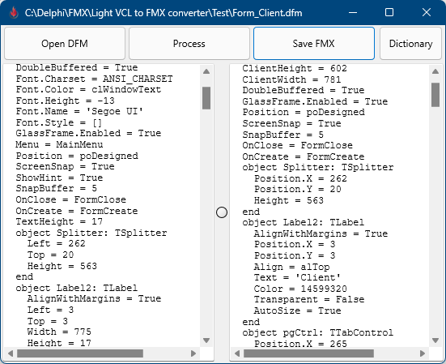
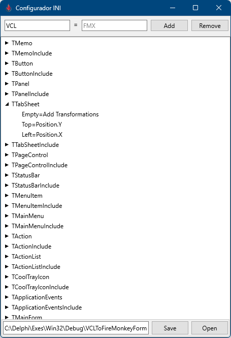

# Light VCL2FMX

VCL to FMX converter
Converts Delphi DFM files to FMX.

This is a major update!

Improvements:
 - True unicode support!
 - Fixed bugs
 - Smaller code
 - Removed all Hints and Warnigs 
 - Better settings editor
 - TImage conversion
 - TImageList conversion
 - Added TAlign replace
 - Got rid of TStream
 - Got read of PChar and other pointers.
 - Got read of uninitialized objects
 - Eliminated some memory leaks. 
 
The program needs the [LightSaber](https://github.com/GabrielOnDelphi/Delphi-LightSaber) library and FastMM4; the Debug build also uses the optional [Autopilot for Delphi](https://gabrielmoraru.com/my-delphi-code/autopilot-for-delphi/) bridge, which lets an AI assistant drive the running app.
